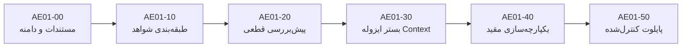

# پلن اجرایی بستهٔ AE-01: آماده‌سازی یک‌مرحله‌ای و Context درست

- شناسه سند: `AE01-PLAN-20260920`؛ تاریخ: `2026-09-20 UTC`.
- وضعیت سند: `AE01-00` آمادهٔ ثبت نهایی است. پایهٔ محدود و فقط‌خواندنی `AE01-10A` در commit `314042ef9c0f230f14fce92720ced0224cf9ce23` وجود دارد، اما کل `AE01-10` تا زمان تکمیل ماتریس چهارحالته و پذیرش مستقل، `IN_PROGRESS` است؛ `AE01-20` تا `AE01-50` کاملاً پیاده‌سازی‌نشده (`UNIMPLEMENTED`) هستند.
- انتساب حاکم: `WA-P1-00B-AE01-20260920-001`؛ استیج `P1-00b` همچنان باز باقی می‌ماند (`P1-00b stays open`).
- تفکیک وضعیت اجرایی: پایه‌های سنجش و معیارهای `AE-00` پیش‌تر تکمیل شده‌اند؛ کار فعلی `AE01-00` صرفاً تصویب محدوده و اسناد است؛ هیچ کد محصولی، تغییر ابزار خودکارسازی، جهش Git یا اقدام زمان اجرا در این گام اعمال نمی‌شود.
- مرجع معماری: [AUTOMATION_EFFICIENCY_PLAN.md](AUTOMATION_EFFICIENCY_PLAN.md) و [PROPOSAL_AUTOMATION.md](PROPOSAL_AUTOMATION.md).

## ۱. اصول حاکم و حفظ زنجیرهٔ نقش‌ها (Role & Process Invariants)

1. زنجیرهٔ مبتنی بر پیشنهاد (`proposal-only chain`) اکیداً حفظ می‌شود:
   - **Gemini Worker**: صرفاً ارائه‌دهندهٔ بایت‌های پیشنهادی (کد، تست و اسناد).
   - **Gemini Reviewer** (مستقل و تازه): بازبین مستقل بایت‌های عینی پیشنهادی.
   - **Codex**: بازبین معنایی نهایی و تنها عامل مجاز برای تعامل با Git و ثبت commit.
2. هیچ سرپرست مدلی جدید (`no model Supervisor`)، نویسندهٔ موازی (`no parallel writer`)، افزایش سقف‌های بودجه (`no limit increase`)، پذیرش خودکار بر اساس صرف وضعیت HEAD (`no auto-acceptance from HEAD`) یا آزادسازی خودکار و مبتنی بر زمان برای رزروهای معنایی (`no auto-release of reservations`) مجاز نیست.
3. رسیدهای منقطع‌شده در اثر محدودیت ظرفیت در P1 صرفاً با اتکا به شواهد عینی و کامل (و نه اتکای کور به HEAD) تعیین تکلیف می‌شوند.

## ۲. سقف‌ها و محدودیت‌های برنامه‌ریزی‌شده (Planned Limits — Not Implemented)

این محدودیت‌ها در بسته‌های کدی پیاده‌سازی خواهند شد و در حال حاضر صرفاً مقادیر مصوب سقف طراحی هستند:
- **استخراج منبع (Source Extraction)**: حداکثر ۲٬۰۰۰٬۰۰۰ بایت برای هر فایل منبع (`<= 2,000,000 bytes/source`) و حداکثر ۸٬۰۰۰٬۰۰۰ بایت کل در هر فراخوانی استخراج (`<= 8,000,000 bytes total/invocation`).
- **بستهٔ تکالیف و پیشنهاد (Task / Proposal Payload)**: حداکثر ۱۶۰٬۰۰۰ بایت (`<= 160,000 bytes`).
- **طول پرامپت (Prompt Payload)**: حداکثر ۳۲۰٬۰۰۰ بایت (`<= 320,000 bytes`).
- **نمایش موجودی (Inventory Display)**: حداکثر ۳۲ کیلوبایت (`<= 32KiB`).
- **داده‌های تشخیصی (Diagnostics Payload)**: حداکثر ۱۶ کیلوبایت (`<= 16KiB`).

## ۳. توالی بستهها و ماتریس اجرایی (Fixed Sequential Order)

توالی اجرای بسته‌ها ثابت، خطی و غیرقابل تغییر است:
`AE01-00 -> AE01-10 -> AE01-20 -> AE01-30 -> AE01-40 -> AE01-50`

## ۴. قرارداد اجرایی مشترک و تحویل بین نقش‌ها

این بخش، ابهام‌های اجرایی را می‌بندد؛ متن هدف هر بسته به‌تنهایی مجوز حدس‌زدن schema، تغییر دامنه یا شروع بستهٔ بعدی نیست.

1. **هویت و دامنه:** هر task باید به `assignment` فعال، `HEAD` کامل، `gap_reference` مستند، manifest مسیرهای منبع و فهرست محدود فایل‌های قابل تغییر متصل باشد. تغییر `HEAD`، assignment یا هر بایت منبع پس از ساخت task، آن task را باطل می‌کند.
2. **قرارداد نقش‌ها:** Worker فقط task دارای تغییر واقعی و non-empty را پیشنهاد می‌کند. Gemini Reviewer فقط روی همان proposal بایت‌محور و در نشست تازه، نتیجهٔ `VERIFIED` یا `CHANGES_REQUIRED` می‌دهد. «بازبینی صرفاً‌خواندنی» هرگز نباید با نقش Worker یا با پاسخ `changes: []` به‌عنوان پیاده‌سازی اجرا شود؛ تا پیش از ساخت adapter مستقل و آزموده‌شده، چنین بازبینی‌ای فقط شواهد مشورتی است و receipt پذیرش نیست. Codex پس از آن، تست و بازبینی معنایی نهایی را انجام می‌دهد و تنها عامل commit است.
3. **مرزهای خواندن:** فقط فایل tracked، مسیر relative و بدون symlink/hardlink ناامن، با سقف ۲MiB برای هر فایل و ۸MiB برای کل فراخوانی خوانده می‌شود. Git فقط برای مشاهدهٔ blob/lineage مجاز است؛ هیچ helper این بسته حق تغییر ref، index، worktree یا Provider را ندارد.
4. **پذیرش ماشین‌پذیر:** هر بسته پیش از ورود به بستهٔ بعدی باید (الف) تست‌های صریح خودش، (ب) test evidence محدود و قابل‌بازتولید، (ج) review مستقل معتبر، و (د) بازبینی نهایی Codex داشته باشد. commit یا سبزبودن یک تست منفرد به‌تنهایی پذیرش نیست.
5. **شکست و تکرار:** خطای schema، scope، امنیت یا قرارداد خروجی، یک failure قطعی است؛ همان task با نام جدید یا retry کور تکرار نمی‌شود. ابتدا باید علت در task/contract اصلاح و با آزمون آفلاین نشان داده شود. خطای انتقال Provider فقط با بودجهٔ retry موجود و نشست تازه قابل تکرار است.

## ۵. مشخصات اجرایی AE01-10 و وضعیت فعلی آن

### ۵-۱. مرز دقیق AE01-10A (پایهٔ موجود)

تابع فقط‌خواندنی `inspect_canonical_evidence(root, behavior_id=None)` در `scripts/two_site_cycle_tools.py` منبع حقیقت فعلی AE01-10A است. ورودی `root` باید worktree معتبر باشد؛ `behavior_id` یا یک شناسهٔ رفتار موجود است یا برای ممیزی کامل `None` می‌ماند. خروجی بیرونی یا `status: VALID` با شمارش seedها و نقشهٔ `coverage` است، یا `status: INVENTORY_INCONSISTENT` با دلیل bounded. چهار حالت زیر فقط مقدارهای `coverage`/`requested_coverage` هستند و با status بیرونی اشتباه گرفته نمی‌شوند:

| حالت پوشش | سناریوی قطعی | انتظار |
| --- | --- | --- |
| `PROVEN_FOR_REQUESTED_SCENARIO` | رفتار شناخته‌شده، record معتبر، blob جاری و lineage معتبر | شواهد همان رفتار کامل است. |
| `PARTIAL_OR_SEED_ONLY` | رفتار شناخته‌شده اما record اثبات‌گر ندارد | seed وجود دارد، اما اثبات ندارد. |
| `NO_MATCHING_EVIDENCE` | `behavior_id` در inventory وجود ندارد | هیچ seed منطبقی وجود ندارد. |
| `UNKNOWN` | رفتار شناخته‌شده اما record آن hash، مسیر، selector یا lineage نامعتبر دارد | دادهٔ متناقض هرگز به موفقیت تنزل نمی‌یابد. |

`AE01-10A` در commit یادشده فقط baseline واقعیِ حالت اول را اثبات می‌کند: ۴۶۵ seed مورد انتظار و واقعی، و یک رفتار بات با پوشش `PROVEN_FOR_REQUESTED_SCENARIO`. این پایه نه پذیرش کامل AE01-10 است و نه مجوز شروع AE01-20.

### ۵-۲. کار بعدی و محدود AE01-10B (ماتریس پذیرش)

تنها کار بعدی AE01-10، تکمیل test matrix آفلاین برای سه حالت باقی‌مانده و حالت inconsistency است؛ بدون تغییر محصول، CLI، Provider، deploy یا schemaهای canonical واقعی. fixture باید یک repository موقت حداقلی با commit واقعی بسازد و مجموعهٔ کامل اسناد canonicalِ موردنیاز (manifest، چهار surface، scenario baseline، base و سه continuation) را با schema صحیح تولید کند؛ fixture حق استفاده از دادهٔ عملیاتی یا network ندارد. سناریوهای لازم:

1. seed شناخته‌شده بدون record → `PARTIAL_OR_SEED_ONLY`.
2. شناسهٔ خارج از inventory → `NO_MATCHING_EVIDENCE`.
3. seed شناخته‌شده با hash/lineage ناسازگار → `UNKNOWN`، بدون تبدیل آن به partial یا proven.
4. manifest، schema یا شمارش ناسازگار → `INVENTORY_INCONSISTENT`؛ دلیل ممکن است کوتاه باشد، اما payload تشخیصی نامحدود مجاز نیست.

پذیرش AE01-10 فقط وقتی برقرار است که baseline واقعی و چهار سناریوی بالا با network fence استاندارد و `APP_ENV_FILE=config/unit-test.env.example` سبز باشند، task/HEAD binding برقرار بماند، و Worker/Reviewer/Codex زنجیرهٔ معتبر داشته باشند. پس از آن، artifact تحویل به AE01-20 شامل نام test selectorها، commit، receiptهای review و فهرست ثابت failure classهاست؛ نه متن پرامپت، سورس یا stream Provider.

### ۵-۳. معیارهای کمی بسته‌های بعدی

برای جلوگیری از «تکمیل ظاهری»، هر بسته علاوه بر تست خود باید artifact زیر را بسازد:

| بسته | artifact لازم برای بازکردن بستهٔ بعدی |
| --- | --- |
| AE01-20 | گزارش preflight ثابت از تمام خطاهای مستقل، با ترتیب پایدار و بدون تماس Provider؛ خطای امنیتی fail-closed است. |
| AE01-30 | بستهٔ context SHA-bound با budget محاسبه‌شده، network fence، closure لازم و آزمون Unicode/bidi. |
| AE01-40 | رکورد telemetry بدون source/prompt/error، قفل پیکربندی startup و آزمون UNKNOWN/null؛ مسیر در میانهٔ چرخه تغییر نمی‌کند. |
| AE01-50 | مقایسهٔ یک cohort هم‌خانواده با مدل/effort/batch/warmth یکسان، coverage usage صریح و معیار کیفیت بدون پس‌رفت. دادهٔ ناقص فقط نتیجهٔ کارایی را `UNKNOWN` می‌کند. |

برای AE01-50، قبل از اجرا cohort، پنجرهٔ زمانی، واحد رفتاری پذیرفته‌شده و حداقل coverage اندازه‌گیری باید در task ثبت شوند. نبود هرکدام، اجرای پایلوت را مسدود می‌کند؛ نه اینکه با شمارش commit یا صفر فرض‌کردن token جایگزین شود.

---

### بستهٔ AE01-00: مستندسازی، تعیین دامنه و تثبیت لنگرهای بایت‌محور (Current Work)
- **وضعیت**: در حال پذیرش نهایی (`Under Final Acceptance`).
- **نتیجهٔ محدود (Outcome)**: تدوین پلن اجرایی کامل، حل صریح یافته‌های F1 و F2 بازبینی، تثبیت لنگرهای جایگزینی یک‌تکه در فایل‌های حافظه و پلن اتوماسیون بدون تغییر کدهای محصول.
- **اهداف غیرمجاز (Non-goals)**: تغییر در کدهای اجرایی، افزودن تست به مخزن، دستکاری شاخه‌ها، تغییر متغیرهای عملیاتی.
- **پیش‌شرط (Prerequisite)**: شواهد تکمیل پایهٔ اندازه‌گیری AE-00 و وجود شواهد کامل از رفع انقطاع قبلی ظرفیت.
- **شواهد پذیرش متمرکز (Focused Acceptance Evidence)**: تطابق کامل متن پیشنهادی، یکتایی و دقت بایتی لنگرهای تغییر در فایل‌های مجاز موجود، ساختار JSON معتبر و عاری از فراخوانی ابزار.
- **مرز بازگشت (Rollback Boundary)**: بازگردانی کامیت مستندات بدون هرگونه اثر جانبی روی سورس، تست یا پایگاه داده.

---

### بستهٔ AE01-10: موتور طبقه‌بندی شواهد و سناریوها (In Progress)
- **وضعیت**: `AE01-10A` محدود و فقط‌خواندنی commit شده است؛ `AE01-10B` (ماتریس چهارحالته، review معتبر و پذیرش نهایی) باقی مانده است.
- **نتیجهٔ محدود (Outcome)**: پیاده‌سازی طبقه‌بندی صریح و ساختاریافتهٔ وضعیت سناریوها در helperهای آماده‌سازی، شامل دقیقاً چهار حالت مجزا:
  1. `PROVEN_FOR_REQUESTED_SCENARIO`: سناریو همراه با شواهد کامل و معتبر در سورس و تست اثبات شده است.
  2. `PARTIAL_OR_SEED_ONLY`: سناریو فقط پوشش جزئی دارد یا صرفاً seed اولیه موجود است.
  3. `NO_MATCHING_EVIDENCE`: هیچ شواهد منطبقی برای سناریو در تاریخچه یا مخزن یافت نشد.
  4. `UNKNOWN`: وضعیت به علت عدم قطعیت یا داده‌های ناکافی نامشخص است.
- **اهداف غیرمجاز (Non-goals)**: تبدیل خودکار وضعیت ناشناخته به موفقیت، حدس زدن شواهد مفقود، استنتاج خودکار وضعیت آزمون‌ها.
- **پیش‌شرط (Prerequisite)**: پذیرش و ثبت نهایی اسناد AE01-00.
- **شواهد پذیرش متمرکز (Focused Acceptance Evidence)**: تست‌های واحد ایزوله برای پوشش هر چهار حالت، رد ورودی‌های مبهم، عدم دسترسی به شبکه و Provider.
- **مرز بازگشت (Rollback Boundary)**: بازگردانی توابع و تعاریف enum/حالت‌های جدید بدون باقی گذاشتن اثر روی لاجیک آماده‌سازی موجود.

---

### بستهٔ AE01-20: پیش‌بررسی قطعی یک‌مرحله‌ای (Unimplemented Code Package)
- **وضعیت**: کاملاً پیاده‌سازی‌نشده (`Entirely Unimplemented`).
- **نتیجهٔ محدود (Outcome)**: پیش‌بررسی ساختاری و schema-aware تمام پیش‌نیازهای ساخت تکالیف در یک مرحلهٔ قطعی بدون جهش در Git و بدون ارتباط با Provider (`deterministic one-shot preflight with no Provider/Git mutation`). گزارش یکپارچهٔ تمامی خطاهای پیش‌پرواز (مانند نمونهٔ چرخهٔ `1d2b8ce0`).
- **اهداف غیرمجاز (Non-goals)**: اصلاح خودکار سورس، اجرای دستورات git commit/checkout/push، تلاش مجدد در صورت خطای امنیتی، خواندن فایل‌های خارج از محدوده.
- **پیش‌شرط (Prerequisite)**: تکمیل، تست و پذیرش بستهٔ AE01-10.
- **شواهد پذیرش متمرکز (Focused Acceptance Evidence)**: بازتولید آفلاین نقص‌های شناخته‌شده و اثبات تشخیص یک‌جای آن‌ها پیش از هرگونه تماس با Provider؛ اعتبارسنجی شکست‌های ساختاری در تست ایزوله.
- **مرز بازگشت (Rollback Boundary)**: غیرفعال‌سازی دروازهٔ preflight جدید در helperها و بازگشت به مسیر بررسی تک‌مرحله‌ای سنتی در مرز چرخه.

---

### بستهٔ AE01-30: بستر هدفمند ایزولاسیون و Context (Unimplemented Code Package)
- **وضعیت**: کاملاً پیاده‌سازی‌نشده (`Entirely Unimplemented`).
- **نتیجهٔ محدود (Outcome)**: آماده‌سازی context متمرکز شامل حصار شبکه (`network-fence`)، بستار فراخوانی‌های دیتابیس/session (`SQL/session closure`)، نگهداری دقیق نویسه‌های یونیکد (به‌ویژه نیم‌فاصلهٔ مجازی U+200C و کاراکترهای دوجهته bidi) و الحاق شواهد لازم در چارچوب سقف بودجه.
- **اهداف غیرمجاز (Non-goals)**: بارگذاری نامحدود سورس‌ها، حذف تست ایزولاسیون شبکه، دستکاری تبدیل نویسه‌های فارسی/یونیکد.
- **پیش‌شرط (Prerequisite)**: تکمیل و تصویب بستهٔ AE01-20.
- **شواهد پذیرش متمرکز (Focused Acceptance Evidence)**: آزمون‌های بررسی بستار مدل‌ها و عدم نشت اتصالات به شبکهٔ خارجی؛ آزمون حفظ تمامیت رشته‌های یونیکد و جداول دیتابیس در تست‌های واحد ایزوله.
- **مرز بازگشت (Rollback Boundary)**: حذف ساختار بستار انتخابی جدید و بازگشت به سازوکار جمع‌آوری حداقل context قبلی.

---

### بستهٔ AE01-40: یکپارچه‌سازی مقید و تلمتری بدون سورس (Unimplemented Code Package)
- **وضعیت**: کاملاً پیاده‌سازی‌نشده (`Entirely Unimplemented`).
- **نتیجهٔ محدود (Outcome)**: یکپارچه‌سازی جریان آماده‌سازی و جمع‌آوری تلمتری بدون افشای متن سورس، پرامپت‌ها یا اسرار (`source-free telemetry`).
- **حل دقیق یافتهٔ F1 (Startup Configuration Lock & Safe Rollback)**:
  - مسیر آماده‌سازی (شامل انتخاب مسیر جدید یا سنتی) **صرفاً از طریق پیکربندی معتبر در زمان راه‌اندازی (`validated startup configuration`)** تعیین می‌شود.
  - این انتخاب برای **تمام طول چرخه ثابت و قفل است** (`fixed for the whole cycle`). هیچ کلید یا ضامن زمان اجرا (`no runtime toggle`) یا سوئیچ دلخواه متغیر محیطی در میانهٔ چرخه وجود ندارد.
  - بازگشت به مسیر قبلی (`Rollback`) تنها در **مرز امن چرخه (`safe cycle boundary`)** و پس از تعیین تکلیف کامل نتایج فعال مبهم (`after any ambiguous active result is resolved`) انجام می‌گیرد.
- **حل دقیق یافتهٔ F2 (UNKNOWN Telemetry Governance)**:
  - داده‌های تلمتری مفقود یا نامشخص (`UNKNOWN/null telemetry`) همواره ناشناخته باقی می‌مانند و **مانع هرگونه ادعای صرفه‌جویی در مصرف توکن یا زمان یا ادعای اثبات بهینه‌سازی در پایلوت می‌شوند**.
  - با این حال، تلمتری نامعلوم **به‌تنهایی مانع پذیرش فنی یا محصولی جداگانه نمی‌شود** مشروط بر آن‌که شواهد کیفی معمول (تست‌ها، بررسی مستقل، صحت ساختاری) با موفقیت عبور کنند.
  - دادهٔ تلمتری مفقود یا null هرگز صفر یا موفقیت قلمداد نمی‌شود (`missing telemetry is never zero or success`).
- **اهداف غیرمجاز (Non-goals)**: ثبت اطلاعات عملیاتی، پیام‌های پرامپت یا خطاهای تفصیلی در لاگ تلمتری؛ تغییر مسیر در حین اجرای تسک؛ جعل صفر برای داده‌های ناموجود توکن.
- **پیش‌شرط (Prerequisite)**: تکمیل، تست و تأیید کامل AE01-30.
- **شواهد پذیرش متمرکز (Focused Acceptance Evidence)**: لاگ‌های ساختاریافته بدون سورس و پرامپت؛ صحت قفل پیکربندی در شروع چرخه؛ رفتار صحیح سیستم در برابر داده‌های تلمتری ناقص یا null.
- **مرز بازگشت (Rollback Boundary)**: تغییر پیکربندی راه‌اندازی به مسیر سنتی در مرز امن چرخه پس از تخلیهٔ تسک‌های فعال و پاک‌سازی وضعیت موقت.

---

### بستهٔ AE01-50: پایلوت واقعی منفرد و مقایسهٔ کنترل‌شده (Unimplemented Code Package)
- **وضعیت**: کاملاً پیاده‌سازی‌نشده (`Entirely Unimplemented`).
- **نتیجهٔ محدود (Outcome)**: اجرای آزمایشی دقیق بر روی دقیقاً یک پایلوت واقعی از تکالیف مورد نیاز، و انجام مقایسهٔ کنترل‌شده با کوهورت همسان (مدل، تلاش، خانواده، پیچیدگی و وضعیت شروع یکسان).
- **تثبیت قواعد F1 و F2 در پایلوت**:
  - مسیر پایلوت در زمان startup تعیین شده و در حین آزمایش تغییر نمی‌کند؛ در صورت بروز شکست، عقب‌نشینی در مرز چرخه پس از رفع ابهام نتایج فعال صورت می‌گیرد (F1).
  - هرگونه تلمتری ناقص، null یا UNKNOWN ادعای بهبود کارایی توکن/زمان را مسدود می‌کند ولی پذیرش فنی رفتارهای دارای تست معتبر را رد نمی‌کند؛ تلمتری مفقود صفر فرض نمی‌شود (F2).
- **اهداف غیرمجاز (Non-goals)**: ادعای صرفه‌جویی بر مبنای تعداد commit، تعمیم نتایج پایلوت تکی به کل مخزن بدون تکرارپذیری، فعال‌سازی موازیکاری کارگران.
- **پیش‌شرط (Prerequisite)**: تکمیل و پذیرش موفق بستهٔ AE01-40 و پایداری کامل زیرساخت گزارش‌گیری.
- **شواهد پذیرش متمرکز (Focused Acceptance Evidence)**: مقایسهٔ شفاف توکن‌های uncached/cached/output و زمان فعال در برابر واحدهای رفتاری پذیرفته‌شده، تأیید بازبین مستقل و Codex.
- **مرز بازگشت (Rollback Boundary)**: غیرفعال‌سازی دائمی مسیر جدید و بازگشت کامل به خط پایه در صورت مشاهدهٔ پس‌رفت کیفی یا عدم تحقق صرفه‌جویی خالص.
